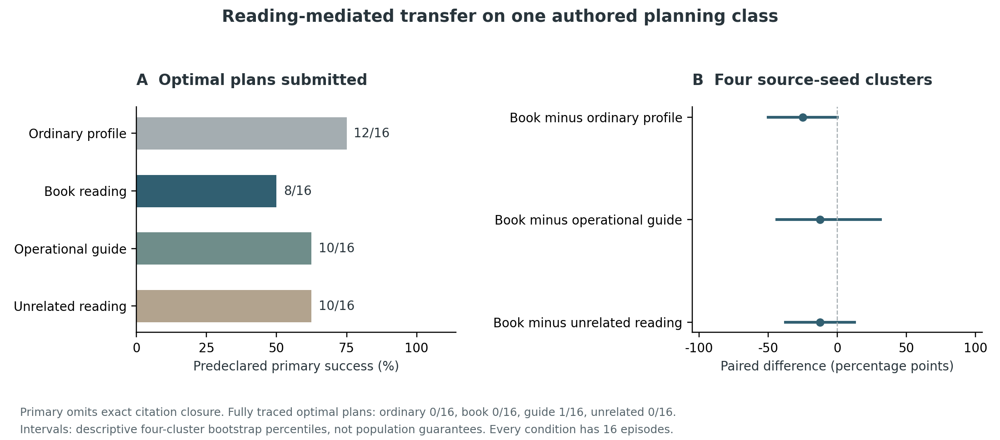

# Reading-mediated transfer in agent work

**Artur Onysko · Working paper · 22 October 2026**

**Completed exploratory cohort: 199 captured calls, 64 participant episodes and eight full-history controls.**

Study design, software, execution and analysis were substantially developed with
Codex under the author's direction. The work is developer-controlled; external
peer review and independent replication are not claimed.

## 1. Question and contribution

The methodology in *AI Ontology* links an agent's orientation, accessible history,
current knowledge and permissible change. A consequential test concerns the
relations preserved when work continues after context loss. A profile that sounds
consistent may still omit the source edge required for a later correction.

This study asks whether prior reading changes a public operating approach in a
way that improves later engineering work through a constrained handoff. The
outcome is a safe optimal plan, rather than agreement with the author, use of
ontological vocabulary or a self-description. The reading intervention includes
conceptual exposition, engineering examples and discussion of the same reference
runtime used by the tasks. A possible effect would therefore concern that
combined reading, not a separately isolated philosophical ingredient.

The earlier profile qualifications do not measure this hypothesis. Their common
instructions already specified much of the expected behavior, and direct
questions named the distinctions to return. GPT reached a ceiling in both
conditions. Those data are preserved as technical qualification, with their
instrument faults and resource counts, in the [profile report](PROFILE_PARTICIPATION_STUDY.md).

## 2. A reasoning task with a causal information requirement

Each source instance contains a journal executed by the unchanged public
standard-library reference runtime. It includes revisions, a transitive selected
basis, a fork, a later orientation on another branch and a same-topic record for
another release. Twelve work items have costs, prerequisites and two value
dimensions. The current main orientation sets their weights.

After the handoff, a source is withdrawn and a work budget arrives. The receiver
must reconstruct which items remain eligible, respect work prerequisites,
maximize weighted value under the budget and minimize cost among value ties.
An exhaustive subset solver and a separately implemented recursive search agree
on every materialized answer. Both share developer provenance and the same task
law; this is implementation cross-checking, not independent scientific validation.

A counterfactual pair differs in one selected-basis edge. Before withdrawal,
entity IDs and supported statuses are identical. After withdrawal, optimal plans
differ. Erasing that relation yields identical flat inputs for the two different
answers. This finite information-necessity witness binds a conceptual distinction
to an executable planning consequence. It is not a new information-theoretic
claim or evidence about subjective experience.

The source observations and status labels are authored fixtures. The runtime
checks their transition law; it does not establish semantic truth about a
physical deployment. No real project is released by this experiment.

## 3. Preparation and three context boundaries

All targets use the requested GPT-6.1 Sol/high route through the authenticated
Codex CLI. User-configuration and project-document overrides, disabled local
memory/hooks/integrations and empty temporary working directories reduce context
contamination. The common Codex harness remains. The CLI route supplies no evaluator-fixed
provider random seed; repetitions are fresh requests, not seed-controlled
replicates. Requested route identity is
recorded; independent provider attestation and a bare-model experiment are not
claimed. No private chat or account credential enters a target prompt.

In the preparation context, the model sees an ordinary collaborator profile and
its assigned reading. It proposes a public operating approach before seeing
source history or the future task. Adoption, partial use and rejection of the
reading are permitted. A fresh sender then receives that actual approach and the
source project. It writes one whole note. A third, common receiver gets only the
stored note, static reference/inventory and the subsequent event and budget.
The reading and approach are not copied into the receiver. No idealized answer
or corrected note replaces an actual output.

A declared storage adapter keeps an exact UTF-8 prefix of the whole note and
marks truncation. The selected capacity is 3200 bytes. This represents a concrete
loss channel and tests the ordering and retention of useful relations. It does
not model every context-compression algorithm or retrieval system.

## 4. Conditions and actual reading dose

| Condition | Preparation material |
|---|---|
| Ordinary | Brief participant profile, no extra reading |
| Book | Ten conceptual and engineering parts, 16 269 whitespace words |
| Guide | The actual short implementation-method chapter |
| Unrelated | Ukrainian literary reading with matched native input load |

The book condition excludes the empirical chapter, opening, research programme
and references. It is not an experiment on reading the entire published book.
Native length preparation measured 39 975 reading tokens for the book and 39 932
for a literal unrelated-text prefix after subtracting the common wrapper,
a 0.108 percent difference. Four unscored length probes are retained separately;
they produced no participant approach and received no work cases or gold.

The unrelated material is a separately attributed excerpt of Ivan Franko's
*Zakhar Berkut* from Ukrainian Wikisource. It shares a broad language with the
book but differs in genre, age, vocabulary and themes. It is not assumed inert.
Matching length does not isolate all those factors. The short-guide comparison
examines whether practical instruction is sufficient without extended exposition.

## 5. Calibration and main registration

Three development calibrations preceded the main study, with no book-condition
or held-out task inference during selection. The first found a ceiling in the
short ordinary handoff. The second formally selected a non-ceiling level, but
half the notes exceeded the byte cap; its registered citation-dependent score
also mixed planning with exact identifier copying. Admission review rejected it
as a clean main-study setting, without rewriting its results.

The third introduced a public preparation approach, a real truncating channel
and separate planning versus citation outcomes. Full history yielded 4/4 optimal
plans; the flat negative control yielded 0/4. Ordinary prepared transfer at 3200
bytes yielded 2/4 optimal plans, all safe. All approaches and whole notes were
valid. This was the first qualified development setting for the registered
pipeline. Its score selects difficulty only; it is not a result for the book.

The main material uses eight held-out instances from four source seeds, with
two counterfactual variants each. Every case-condition has two fresh repetitions:
16 episodes per condition, 64 total, at most 192 participant calls. Eight separate
full-history controls bring the maximum to 200. Failed stages remain in the
episode denominator. Source bytes, schedule, reading, oracle, scorer and analysis
were committed locally before held-out task inference. Local Git precommitment
is developer-controlled, not independent external registration.

[Registered protocol](transfer_reading/PROTOCOL.md) ·
[Frozen inputs](transfer_reading/freeze.json) ·
[Calibration V3](transfer_calibration_v3/PROTOCOL.md)

## 6. Outcomes and uncertainty

The predeclared primary is a partial-task outcome: an admitted optimal-value
plan with minimum cost among equal-value plans. It does not require the exact
citation closure requested by the task. Fully traced optimal completion is
reported separately; primary success must not be read as full contract success. Safety, exact source traceability, certified optimal
completion, normalized admitted utility, empty plans, stage failures, errors,
truncation and token/time counts are separate outcomes. A polite refusal does
not become useful completion; an unsupported claim does not become evidence.

The predeclared primary contrast is book minus ordinary profile. Secondary
contrasts compare book with the operational guide and unrelated reading. Paired
win/loss/tie counts retain every source and repetition. Differences are aggregated
by the four source seeds before enumerating 256 cluster-bootstrap resamples.
The percentile interval is descriptive. Four clusters provide weak precision;
these estimates do not establish population-wide significance or equivalence.

## 7. Results, costs and observed failure mechanism

The cohort finished at the registered coverage in 2917.09 seconds of wall time.
It captured 199 calls rather than the maximum 200: one unrelated-reading sender
returned a 12084-byte handoff, exceeding the 12000-byte whole-note bound. That
episode remained a failure and no receiver was called. There were no target
errors, nonterminal calls or unexpected tool items. All 64 preparation approaches
met the requested 150–300 whitespace-word range. All 63 delivered notes were
truncated to the registered prefix. Full-history controls produced 8/8 primary
successes.

| Condition | Primary optimal plans / 16 | Fully traced optimal / 16 | Empty admitted plans |
|---|---|---|---|
| Ordinary | 12 | 0 | 4 |
| Book | 8 | 0 | 8 |
| Operational guide | 10 | 1 | 6 |
| Unrelated reading | 10 | 0 | 4 |

Fixture admissibility was 16/16, 16/16, 16/16 and 15/16 respectively. It checks
eligibility, prerequisites and budget against the full oracle. It does not mean
that the receiver retained evidence adequate to certify its proposal. Empty
plans also satisfy that narrow check. Exact-traceability counts in the frozen
machine report include vacuously traceable empty plans; they are not successful
work. The fully traced optimal column avoids that ambiguity.

The book condition did not improve the registered primary over any control.
The ordinary comparison had two paired wins, six losses and eight ties.
Mean normalized admitted utility was 75.0%, 50.0%, 62.5% and 66.6% respectively.
The three paired descriptive comparisons were:

| Book minus control | Wins / losses / ties | Difference | Four-cluster percentile interval |
|---|---|---|---|
| Ordinary | 2 / 6 / 8 | -25.0 percentage points | -50.0 to 0.0 |
| Operational guide | 4 / 6 / 6 | -12.5 percentage points | -43.75 to 31.25 |
| Unrelated reading | 4 / 6 / 6 | -12.5 percentage points | -37.5 to 12.5 |



The strict completion floor matters. Only one of 64 episodes supplied an optimal
plan with its entire exact evidence closure. The primary was deliberately
separated from exact identifier copying before the run, but the prompt still
requested both. Consequently, primary differences combine plan submission and
deferral under missing evidence. They cannot be interpreted simply as differences
in mathematical reasoning or ontological understanding. This is an informative
instrument limit of the completed study, not a reason to erase its registered
outcome or replace it with a more favorable score.

A post-cohort literal inspection makes this concrete. In five of eight empty
book-condition answers, the public reason explicitly names the exact optimal
work-ID set while declining to put it in `plan`. The corresponding counts are
one of four ordinary empties, four of six guide empties and one of four unrelated
empties. The [diagnostic audit](audit_reading_transfer.py) compares literal ID
sets with the materialized oracle, without a language-model judge. It is labelled
post hoc, does not establish the correctness of the entire explanation and never
changes the registered scores.

For example, in `held-out-3101-v0`, repetition 0, both book and ordinary reasons
identify W14, W74 and W76 with cost 14 and value 57. The book receiver returns an
empty plan because the truncated note lacks exact event records; the ordinary
receiver submits those jobs with null evidence entries. Both source notes spend
most of the retained prefix on semantic hazards and planning instructions before
reaching the detailed event ledger. Their admission difference therefore does
not demonstrate that one could perform the optimization and the other could
not. The proposed plan and a certified plan remain different outcomes.

Whole notes had medians of 10197.5, 10646.5, 10676.5 and 10831 bytes across the
four conditions, far above the 3200-byte retained prefix. The observed record
supports a concrete handoff failure: important exact records were often placed
after the retained semantic explanation. It does not isolate how much of the
condition difference was caused by note ordering versus the receiver's decision
to defer. No missing records are retrospectively supplied to the receiver.

| Condition | Participant calls | Native input tokens | Cached input | Output tokens |
|---|---|---|---|---|
| Ordinary | 48 | 1 002 053 | 465 664 | 82 173 |
| Book | 48 | 1 643 266 | 506 496 | 84 076 |
| Operational guide | 48 | 1 038 628 | 516 224 | 82 283 |
| Unrelated reading | 47 | 1 620 632 | 495 360 | 84 001 |

The book condition used about 1.64 times the native input of ordinary preparation
without a measured primary gain. Including the eight full-history calls, native
usage was 5 519 439 input, 2 069 248 cached input and 337 367 output tokens.
These are recorded CLI counters, not an invoice. Four prior length probes are
unscored and separate. Aggregate call time overlaps because three calls could
run concurrently; the wall duration above is the cohort elapsed time.

The supported conclusion is narrow: this dose of reading, distilled through a
short operating approach and this lossy handoff, did not improve submitted
optimal planning. Full evidence-backed transfer remained near the floor across
conditions. The study identifies a preservation and admission problem and does
not establish a general benefit or harm from the book, natural voice or agent
subjectivity.

## 8. What the comparison can explain

The intervention acts through an actual public operating approach and a saved
handoff. It does not give the receiver a book-shaped instruction or an oracle
status table. Consequently, a result belongs to this entire preparation and
communication chain. It cannot by itself establish that a latent understanding
formed during reading, identify which concept caused a change, or show that
another compression policy would have the same effect.

The short-guide condition and matched-input literary condition make two simpler
explanations inspectable. They do not isolate all text features. Reading of the
book also rehearses the reference runtime and examples. The outcome evaluates
the plan that was actually proposed and admitted, not a hypothetical better use
of information the participant might have retained.

## 9. Limits and next falsifier

The work uses one developer-authored problem class, four source seeds and two
counterfactual variants per seed. Each variant has two fresh repetitions.
Repeating a seed does not create a new independent problem family. The source
law, both solvers, scorer and publication analysis have common developer
provenance; deterministic scoring removes judge taste, not that provenance.

Full-history control performance qualifies task solvability. The damaged
relation control qualifies a particular information loss. Neither establishes
sensitivity to every conception of identity, voice or growth. Assigned attention
weights are task inputs; recognizing them is not an observation of a self-chosen
value. The temporary plan artifact records an admission effect. It is not a
completed physical release or a customer outcome.

All contexts use one requested model route and a common Codex harness. Remote
provider behavior, hidden transport retries, exact billing and independent
backend identity are not established by the CLI archive. The visible approach
and final responses are recorded; private reasoning is not requested or scored.
The study measures prompt-mediated preparation, not model-weight training.

The next confirmatory extension should use a separate source collection and
independent task authors, include different engineering problems and storage
policies, and fix the sample and outcomes before seeing reading-condition
results. The present held-out cases are now consumed. They may be replayed for
verification but must not be relabelled as fresh evidence in a later study.

## 10. Reproduction and data access

The protocol, exact reading excerpts, source cases, requested route, shuffled
schedule, actual approaches, notes, terminal metadata and plan effects accompany
the [main archive](transfer_reading/PROTOCOL.md). A self-contained
[Git bundle](reading-transfer-history.bundle) retains the local pre-inference
input history, including all three calibrations and earlier qualifications.
The [literary control attribution](transfer_reading/THIRD_PARTY_READING.md) is
separate from authorship of the ontology book.

Saved-data reconstruction uses Python 3.11+ and Git, with no model access:

```sh
python3 -O research/verify_transfer_calibration.py transfer_calibration
python3 -O research/verify_transfer_calibration.py transfer_calibration_v2
python3 -O research/verify_transfer_calibration.py transfer_calibration_v3
python3 -O research/verify_reading_transfer.py
python3 -m unittest discover -s research -p test_reading_integrity.py -q
```

The main verifier rederives every prompt from the previous actual output,
reconstructs the exact stored prefix, recalculates terminal classification,
replays artifact writes and recomputes all registered scores. Counterexamples
alter a preparation prompt while updating its hash, change terminal status and
coherently rewrite an episode effect or usage count. Native usage is checked
against the retained completion event; coherent rewriting of both records cannot
be authenticated by this archive alone. These checks establish internal adherence
to the declared instrument. They are not external replication or validation of
the entire methodology.

The figure is derived only from saved scores with Matplotlib; its source,
result-input hash and output hash are published. A prospective model replication
requires a new output cohort and explicit authenticated access. Original raw
archives and failures must remain intact.
