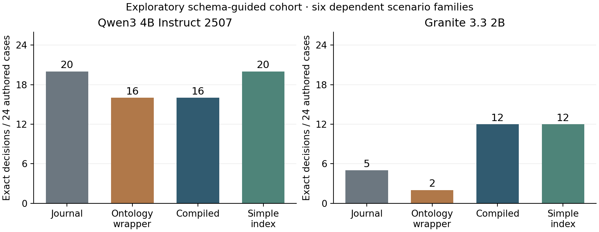

# Scoped Continuity in Agent Memory

**History, compiled context and an information-matched simple index**

Artur Onysko · Independent research · 22 October 2026

Working paper accompanying *AI Ontology. Book One: Organization of Self*, v3.3.0. Research, implementation, execution, analysis and manuscript preparation were substantially assisted by Codex under the author's direction. No independent peer review is claimed.

Companion profile evaluations, including GPT-6.1 Sol, have separate questions, protocols and results in [Position, justified revision and methodological reading](PROFILE_PARTICIPATION_STUDY.md). The 384-call results in this paper remain unchanged.

## Abstract

Agent memory requires decisions about which claim is current, where it applies, whose evidence supports it and when its basis has been withdrawn. We present a bounded executable specification of these relations and a developer-run local diagnostic study. Twenty-four authored cases in six dependent families were presented under four conditions: a complete journal, an ontology-framed journal, a compiled current context and an information-matched simple index. Two quantized local models each received all cases. A first cohort of 192 calls reached an output-encoding floor and is retained in full. An exploratory follow-up of 192 calls used separate schema-constrained fields. Qwen3 4B answered 20/24 cases exactly with the journal, 16/24 with the ontology wrapper, 16/24 with compiled context and 20/24 with the simple index. Granite 3.3 2B obtained 5/24, 2/24, 12/24 and 12/24, respectively. Compilation reduced reported prompt tokens relative to the journal, but did not outperform the simple index in aggregate for either model. These mixed results do not establish a general behavioral benefit of ontology framing. The contribution is an inspectable transition contract, a reproducible diagnostic and concrete failure cases separating valid state, correct model use and useful outcomes. Voice, identity, subjective experience and the effect of reading the accompanying book were not measured.

## 1. Research question and contribution

A record of an earlier decision is insufficient to determine whether that decision remains applicable. Its scope may differ, a later claim may supersede it, its source may be withdrawn, or another branch may have developed independently. These distinctions matter even when the underlying language model is capable and the history fits inside its context window.

This work asks a narrow question: under a fixed transition law and the same authored source history, does an explicit organization of continuity improve a model's current-state, provenance, stance and citation decisions? Three contrasts were declared before each cohort: ontology framing versus a strong journal; compiled context versus that journal; and compiled context versus a simple index carrying the same substantive information. The last control tests whether specialized presentation adds value beyond ordinary structured state.

The accompanying book offers a broader methodology relating identity, memory, voice, commitments and relationships. This study tests one operational slice. It neither validates that whole account nor reduces its conceptual claims to a status-classification score. The executable contribution is a finite, inspectable reference design rather than a novel storage algorithm. Its principal empirical result is that gains from deterministic context preparation were model-specific and did not require the ontology presentation in the tested aggregate outcomes.

## 2. Relation to existing work

The journal and replay follow the established event-sourcing pattern described by Fowler. Doyle's truth-maintenance work is a direct predecessor for recording reasons and revising dependent beliefs. Our narrower reference mechanism traverses declared dependencies, marks review requirements and guards decision admission; it does not implement a general justification engine or dependency-directed backtracking.

AGM studies contraction and revision of logically closed theories. Our caller-labelled natural-language records have no logical consequence operator or implementation of the AGM postulates. An explicit revision link is therefore not an AGM implementation. These predecessors locate the mechanisms; no comparative advantage over them was measured.

Contemporary overlaps extend beyond storage. [MemTX](https://arxiv.org/abs/2607.23929v2) stages belief commits and gates actions; [TOKI](https://arxiv.org/abs/2606.06240v1) specifies isolation and provenance for contradiction resolution. [RIPA/Enoch](https://arxiv.org/abs/2609.00546v2) governs migration of identity, memory and software body, while [PAI-Bench](https://arxiv.org/abs/2609.13637v1) separates recall, expression and enactment of a versioned identity contract. These are related scopes, not evaluated baselines here. Their existence rules out treating either explicit belief state or governed identity as an unexplored field.

[MemGPT](https://arxiv.org/abs/2310.08560v2) organizes interaction with memory beyond a model's immediate context through a hierarchy of storage and control flow. Our implementation instead specifies a small transition system and exposes exact current-state and provenance relationships. We did not reproduce MemGPT's evaluations or compare against a deployed MemGPT/Letta system.

[LongMemEval](https://arxiv.org/abs/2410.10813v2) distinguishes extraction, temporal and multi-session reasoning, knowledge updates and abstention. Those distinctions motivate separating revision from missing scope and withdrawn evidence. Our 24 short authored cases are not LongMemEval items, and the reported scores are not benchmark scores on that dataset.

[LoCoMo](https://arxiv.org/abs/2402.17753) evaluates memory across extended conversations through several tasks. The present histories are much smaller, mechanically generated and explicitly typed. They isolate a few failure modes at the cost of conversational realism. They cannot establish long-term interaction quality.

The relational model is also compatible with ordinary provenance practice. [W3C PROV-O](https://www.w3.org/TR/2013/REC-prov-o-20130430/) distinguishes entities, activities and agents. A provenance relation makes an attribution inspectable; it does not establish that a natural-language observation is true or that the record was produced by an authenticated person. This same boundary applies to our actor labels and evidence references.

## 3. Executable specification

The public reference package uses Python's standard library and SQLite. An append operation is admitted against an expected journal head inside a transaction. The finite reducer preserves claim revisions and branch histories. Orientation is versioned separately from evidence. A context compiler selects a branch, topic and scope and includes the required evidence and revision history. A decision is committed only if its original context remains current.

For a query q = (branch, topic, scope), let c be its current claim, if one exists. Let B(c) be the observation basis of that current claim, excluding merely historical bases retained for explanation. Let R be the branch's retired observation set. The projected status is unknown when no claim is available; needs-review when B(c) intersects R; otherwise it is the current authored claim status. Retirement does not assert that the old claim is false. A later independent revision need not inherit the old basis's invalidation.

This is a rule about the state represented by records. It is not a semantic truth oracle. Claims receive explicit status labels from the trusted caller. Source retirement names an exact prior observation and its content hash. The implementation tests that the dependent current view changes while the historical record remains available. Branch-local retirement and reopening are covered by separate tests.

The model-turn interface supplies orientation and evidence, snapshots its request, checks the returned route label and structured response, and rejects stale decisions or unavailable citations. A declared ordinary answer using retired current basis is refused. That guard cannot infer whether arbitrary prose entails its citations or whether a nominal abstention secretly asserts a conclusion. The reference package includes a negative test in which unsupported prose passes structural checks.

Forty-nine systems tests pass in the published source-pinned report. They include cooperative concurrent writers, fresh-process recovery, termination before transaction commit and seven retirement tests. These systems tests perform no LLM inference. They establish bounded implementation behavior under authored fixtures, not empirical interaction benefit. Full replay is limited to 4,096 operations; immutable map copying gives a quadratic worst-case replay cost and potentially cubic cumulative append cost. Million-record scaling is a separate design, not a measured property of this implementation.

The edition additionally supplies two retrospective engineering cases from an author-owned integration component. Selected historical function bodies are published unchanged with a fixture SQLite/file adapter. Under an injected post-commit exception, the baseline reports refusal despite one durable event; the repair reconciles the exact record without a second append. A second replay shows an intermediate repair losing an uncertainty fence after transient input-read failure and automatically appending when the input returns; the final repair preserves uncertainty and performs no second append. Three separate tests cover these outcomes and excerpt hashes. Deployment bindings and append policy are replaced by the declared adapter, and historical origin is developer-reported. These comparisons demonstrate the selected mechanisms under specified faults, not natural fault frequency, whole-agent benefit or a new LLM cohort.

## 4. Cases, conditions and frozen design

The dataset comprises six families with four lexical variants each: revision, absent scope, withdrawn current basis, fork isolation, peer attribution and neutral control. Variants change the topic and release scope. Every history also contains three unrelated observations. In a fork case, the reviewed branch inherits the earlier positive claim while the main branch subsequently receives a negative revision.

Cases and answer keys were authored before inference. A manual family-level key is checked against the runtime's projected status before a case can be used. This agreement tests the specified transition law; it is not an independent oracle about natural-language truth. The cases are not random draws from a task population. Each family has equal weight in the descriptive aggregate, and variants within a family are dependent.

The four conditions are defined below. Their shared instruction already explains revision, scope, fork inheritance, retirement, attribution and required citations. Thus the journal is a substantive baseline with the relevant rules available.

| Condition | Information supplied | Distinction being tested |
|---|---|---|
| Journal | Complete ordered history | Strong history baseline |
| Ontology wrapper | Same history, orientation and relational reminder | Framing plus additional instruction text |
| Compiled | Actual dependency-closed current context | Deterministic preprocessing and selection |
| Simple index | Same compiled information, ordinary field names | Parsimony control for presentation |

Compiled context directly includes the projected current status. Its contrast with the journal therefore includes deterministic work performed before model reading. It cannot isolate an effect of terminology or latent self-understanding. The simple index preserves all substantive fields and values but renames profile, view and evidence as settings, current_record and records. Both compact conditions are generated by the same compiler; the simple index is not an independently implemented memory mechanism. The serialized prompts sort keys, so renaming also changes some field order. This contrast does not isolate naming from ordering. It is an information-matched, not exactly token-matched, control. The ontology wrapper adds text and organization, so its result cannot be attributed to vocabulary alone.

The compiler normally binds contexts to a store-specific head. For the published cases, the runner replaces that UUID-dependent head with a deterministic digest of case operations and recomputes the context hash. This normalized object is experiment data; it is never used as a live decision-admission token.

The design, scenarios, prompts, scorer, runner and installed model digests were frozen and committed locally before each scored cohort. The exact input commits are preserved in the accompanying Git bundle. This is a developer-controlled precommitment, not an independently registered protocol, an independent timestamp or protection against author misconduct.

## 5. Models and execution

The models were Qwen3 4B Instruct 2507 Q4_K_M and IBM Granite 3.3 2B Q4_K_M through a local Ollama 0.20.3 daemon. The Granite bundle reports a parameter size of 2.5B despite its 2b registry tag. Exact bundle digests, template hashes, parameter hashes and model details are in each freeze file. The [Qwen model card](https://huggingface.co/Qwen/Qwen3-4B-Instruct-2507) and the [Granite registry entry](https://ollama.com/library/granite3.3:2b) identify the source families; the local digests identify what was actually tested.

Requests used temperature 0, seed 317, context 8,192 and a maximum of 128 generated tokens. Conditions and cases were shuffled with seed 317 inside each model block. Requests were sequential on one NVIDIA RTX 3060 with 12 GB VRAM. Each model received one neutral unscored warm-up in each cohort. Only the model loaded by the experiment was unloaded at the end of its block. No external model API or model-generated tool action was used.

Each cohort comprised 24 cases × 4 conditions × 2 models = 192 scored requests. There were no retries, repaired answers, best-of selections or excluded failed requests. Backend terminal status, route label, prompt and completion counts, wall time, final visible response and a request hash were recorded. Private reasoning was neither requested nor retained. Model metadata matched the frozen entries before and after both runs. Fixed decoding does not guarantee bitwise repeatability across hardware or backend versions.

Before the first cohort, a preflight check found that the backend returned identical parameter entries in a different line order. Hashing was changed to sort complete parameter lines; the original failed freeze and the explanation remain archived. This happened before any scored call and changed no cases, prompts or answer keys.

## 6. Outcomes and the first instrument failure

The primary outcome is exact agreement of all required values with successful terminal completion. Citation order is normalized; duplicates or extra fields are invalid. No LLM judge is used. In the follow-up the four fields are status, origin, stance and cites. Stance must be abstain for unknown or needs-review; cites must include the current claim and every observation in its current basis, or an empty list when no claim exists. An existing valid citation alone does not earn full credit.

The first cohort encoded status and origin together as a text value, with a metasyntactic example STATUS|ORIGIN. All 192 requests completed, but every exact score was zero. Qwen copied the literal placeholder in 96/96 outputs. Granite did so in 46/96 and produced the expected shape in 49/96. This is an instrument floor: output encoding prevented a useful estimate of the underlying state-decision ability. The all-zero scores and raw responses are published, rather than discarded or reinterpreted as proof for or against ontology.

After inspecting that cohort, we froze a new exploratory protocol. It retained the cases, conditions, gold semantics, model routes and resource budgets, but clarified the shared output instruction and supplied a JSON schema with separate status and origin fields. Both changes occurred together and their individual effects cannot be isolated. The same cases were reused, so the follow-up is not a held-out confirmation. A prose error in its frozen protocol says “three fields”; the executable schema and scorer use the four fields named above. No input or output was altered to correct that wording after the run.

## 7. Exploratory follow-up results

All 192 follow-up responses were shape-valid and terminal, with no recorded backend errors. The exact results and reported prompt tokens are below. Each accuracy denominator is 24 authored cases, not 24 independent natural episodes.

| Model | Condition | Exact / 24 | Prompt tokens |
|---|---|---|---|
| Qwen3 4B | Journal | 20 | 25,076 |
| Qwen3 4B | Ontology wrapper | 16 | 27,476 |
| Qwen3 4B | Compiled | 16 | 21,506 |
| Qwen3 4B | Simple index | 20 | 21,458 |
| Granite 3.3 2B | Journal | 5 | 26,124 |
| Granite 3.3 2B | Ontology wrapper | 2 | 28,572 |
| Granite 3.3 2B | Compiled | 12 | 22,433 |
| Granite 3.3 2B | Simple index | 12 | 22,457 |



For Qwen, compiled context won four paired cases against the journal and lost eight, with twelve ties. Its four gains were fork cases; its losses concerned retirement stance and peer attribution. Against the information-matched simple index it won none and lost four. For Granite, compiled context won eight cases and lost one against the journal, with fifteen ties. Against the simple index it won three and lost three, with eighteen ties. Equal Granite totals therefore conceal different errors and are not evidence of functional equivalence.

The frozen analysis also reports a family-cluster bootstrap with 5,000 resamples and seed 317. With only six clusters these intervals are exploratory and unstable. Compiled minus journal has an interval of approximately -66.7 to +33.3 percentage points for Qwen and -4.2 to +62.5 for Granite. Compiled minus simple index has intervals of -50.0 to 0 for Qwen and -29.2 to +33.3 for Granite. These are not confirmatory population estimates. No significance, equivalence or unique-superiority claim is made.

Compiled context used 14.2% fewer reported prompt tokens than the journal for Qwen and 14.1% fewer for Granite. The simple index used nearly the same prompt counts as compiled context. Extra ontology framing increased prompt counts without improving exact scores in either model. Median request wall times in the follow-up ranged from approximately 836 to 995 ms across model-condition groups. Cache, loading and host contention confound latency; these measurements are not energy, money or deployment-throughput estimates.

## 8. Failure cases and what the implementation can enforce

In case f2v0, Qwen's compiled response correctly named needs-review and cited the current claim and its withdrawn basis, yet selected stance answer. The exact scorer marked it wrong. The full runtime would reject an ordinary answer under retired current basis, but the diagnostic cohorts only score model outputs; they do not insert them as decisions. The distinction matters: a guard could prevent this admission without making the model's answer correct or completing the user's task.

In peer-attribution case f4v0, Qwen classified the origin as self under compiled presentation and peer under the simple index. The substantive evidence was identical; the field organization differed. This observed sensitivity is a direct counterexample to assuming that richer ontology presentation is automatically safer for provenance. It suggests a future held-out test of field naming, ordering and prompts, rather than a retrospective repair of the published score.

In fork case f3v0, Qwen's journal answer cited a later main-branch revision that was unavailable to the queried review branch. Both preprocessed conditions returned the inherited earlier claim correctly. Here deterministic branch selection removed an observed reading error. Granite nevertheless showed other citation and attribution failures, and the compiled condition did not solve retirement stance for either model across this family.

These examples separate three layers: the represented state can be correct; the model can still use it incorrectly; a decision gate may reject part of that incorrect behavior. Admission, semantic support and useful completion require separate measurements. A rejection is a detected failure, not an accurate answer.

## 9. Separate real-model integration smoke

Two additional calls exercised the actual agent_cycle.run_turn against a disposable SQLite history, using the same local model bundles and a separate 192-token output budget. They are not part of either 192-call score. Qwen reached the output limit and was rejected before commit; its journal sequence remained 5. Granite returned a terminal answer citing the latest observation and claim, and the journal advanced from sequence 5 to 6. Its response explained the contradiction but did not explicitly answer every requested unknown.

The smoke report preserves route metadata, counts, admission outcomes and the committed visible response. The rejected Qwen text was not retained by that adapter; its terminal length status and token count were retained. This limits inspection of that smoke failure. Neither case establishes voice quality, comprehensive semantic support or long-run reliability. They demonstrate a real local adapter path and a concrete incomplete-output refusal, with one admitted turn.

## 10. Validity, interpretation and next tests

Internal validity is limited by developer authorship of the scenarios, gold, implementation and analysis. The manual key and runtime projection share the same specified semantics. The follow-up was designed after inspecting the first run, changed two output-instrument components and reused all cases. No blinded external evaluator or replication has yet been obtained. Source hashes establish consistency with published bytes, not independent observation of execution.

Construct validity is narrow. These are English structured-state decisions with short contexts and explicit status labels, not unrestricted conversation, memory formation, semantic truth discovery, subjective self-recognition or the effect of reading a book. The result does not measure migration continuity, relational quality or helpful disagreement. Small quantized models on one machine and one fixed seed provide little basis for transfer to larger systems or other languages. Families are only six, and their variants are strongly related.

The compact-condition comparison retains provenance, scope, revision and required dependencies in both inputs. It therefore cannot establish that removing those relations is harmless. Nor does it compare the compiler with an independently built simpler retrieval or memory system. Its measured contrast concerns presentation of the same preprocessed information, including field names, wrapping and order.

The observed aggregate results support a restrained practical interpretation: deterministic current-state preparation can be useful for a particular reader, while ordinary field naming remains a serious baseline. Specialized framing has an empirical burden of proof. A richer conceptual vocabulary may still help an engineer specify requirements, but that value requires its own evidence and cannot be inferred from these scores.

The nearest confirmatory extension should use unseen scenario families and preregistered success criteria, isolate schema from wording changes, vary field names and order independently, include a content-matched concise summary, and assess both correct answers and safe-but-incomplete refusals. Natural-task episodes and an independent evaluation are needed before deployment-benefit claims. Voice and book-reading effects require distinct instruments and outcomes; adding more status cases would not measure them.

## 11. Reproducibility and provenance

The repository includes both frozen protocols, all cases and prompts, model pins, runners, scorers, completions, warm-up metadata, analyses and losslessly compressed raw responses. Local input commits are 82f55aabb3aa47dd4e39cfec6ecb9fbe1ed3995f for cohort one and 3a8071d18bad6c2196df55ee476a4e92558403db for the follow-up. The accompanying Git bundle preserves their ancestry even when the publication commit differs. They are local historical objects, not independent registration receipts.

The published runtime includes subsequent canonical-JSON and UTF-8 validation repairs. The experiment remains tied to its original source snapshots; the verifier reconstructs those pinned bytes from the self-contained bundle instead of silently substituting the newer runtime.

Offline consistency checks require Python 3.11+ and Git, with no network or model calls:

```sh
python3 -m unittest discover -s examples -q
python3 -m unittest discover -s research/continuity_pilot -q
python3 -m unittest discover -s research/continuity_pilot_v2 -q
python3 -m unittest discover -s research -p 'test_integrity.py' -q
python3 -m unittest discover -s research/engineering_cases -q
python3 research/verify_studies.py
```

The research README documents archive extraction, exact-score regeneration, historical inputs and a fresh output directory for prospective reruns. The original runner refuses to append to existing results. Inference reruns require the exact model bundles and an explicitly operated local backend; they may yield different bytes on other platforms.

An audit of v3.1.0 found that Python optimization could disable assertion-based archive checks. A changed recorded prompt was rejected by the normal command but incorrectly passed with `-O`. In v3.3.0 these checks use explicit exceptions, including the summary's archive hash check. Four regression tests cover unchanged archives, prompt tampering, coherently rehashed prompt tampering and optimized summary validation. Frozen experiment inputs and results are unchanged.

The study reports 384 scored decisions, four unscored warm-ups and two separate integration smoke calls. Forty-nine systems tests and ten design tests are separate code checks. None of these counts is a count of independent natural episodes or demonstrations of consciousness.

## Conclusion

A continuity architecture should make scope, revision, evidence origin and invalidation inspectable. That specification alone does not guarantee that a model will use it correctly. In this local exploratory study, compilation helped Granite relative to the complete journal, yielded a lower aggregate Qwen exact score, and failed to outperform a simple information-matched index in aggregate for either model. The ontology wrapper did not improve the baseline. The implementation, unsuccessful first instrument, follow-up data and failure cases are published together so that the method can be criticized, simplified and tested beyond its initial setting.

## References and contribution statement

Doyle, J. *A Truth Maintenance System*. Artificial Intelligence 12(3), 1979, pp. 231–272. DOI: 10.1016/0004-3702(79)90008-0. [Author's MIT report AIM-521](https://dspace.mit.edu/handle/1721.1/5733); report abstract consulted.

Alchourrón, C. E., Gärdenfors, P. and Makinson, D. *On the Logic of Theory Change: Partial Meet Contraction and Revision Functions*. The Journal of Symbolic Logic 50(2), 1985, pp. 510–530. DOI: 10.2307/2274239. [Published article](https://fitelson.org/piksi/piksi_22/agm.pdf), abstract and §§1–2 consulted.

Fowler, M. *Event Sourcing*. 2005, draft architecture essay. [Author's text](https://www.martinfowler.com/eaaDev/EventSourcing.html), event-log and reconstruction sections consulted.

Packer et al. *MemGPT: Towards LLMs as Operating Systems*. arXiv:2310.08560v2, 2024. [Primary source](https://arxiv.org/abs/2310.08560v2).

Wu et al. *LongMemEval: Benchmarking Chat Assistants on Long-Term Interactive Memory*. ICLR 2025; arXiv:2410.10813v2. [Primary source](https://arxiv.org/abs/2410.10813v2).

Maharana et al. *Evaluating Very Long-Term Conversational Memory of LLM Agents*. arXiv:2402.17753, 2024. [Primary source](https://arxiv.org/abs/2402.17753).

Lebo, Sahoo and McGuinness, eds. *PROV-O: The PROV Ontology*. W3C Recommendation, 2013. [Primary source](https://www.w3.org/TR/2013/REC-prov-o-20130430/).

Qwen Team. *Qwen3-4B-Instruct-2507 model card*. [Primary source](https://huggingface.co/Qwen/Qwen3-4B-Instruct-2507). Exact tested quantized bundle in the published freeze.

IBM Granite model family. *Granite 3.3 2B, Ollama distribution*. [Registry](https://ollama.com/library/granite3.3:2b). Exact tested bundle in the published freeze.

[Ollama chat API](https://docs.ollama.com/api/chat), for the local request and response interface. Backend version 0.20.3 was observed in this run.

Artur Onysko established the conceptual direction, scope and editorial requirements. Codex substantially developed the executable specification, experiment materials, analysis and prose under that direction. AI-assisted production is disclosed throughout the accompanying edition. The work is an author-published working paper; methodological review, external replication and historical priority remain open. No funding or deployment outcome is claimed.
